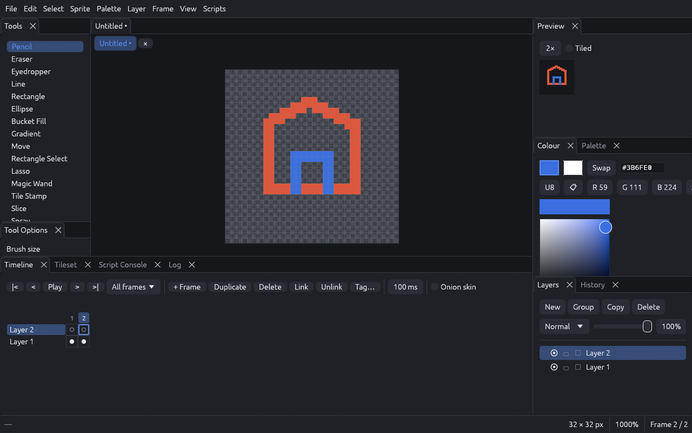
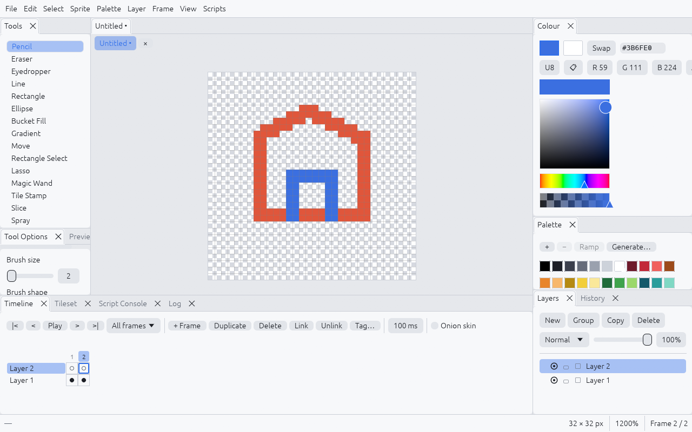
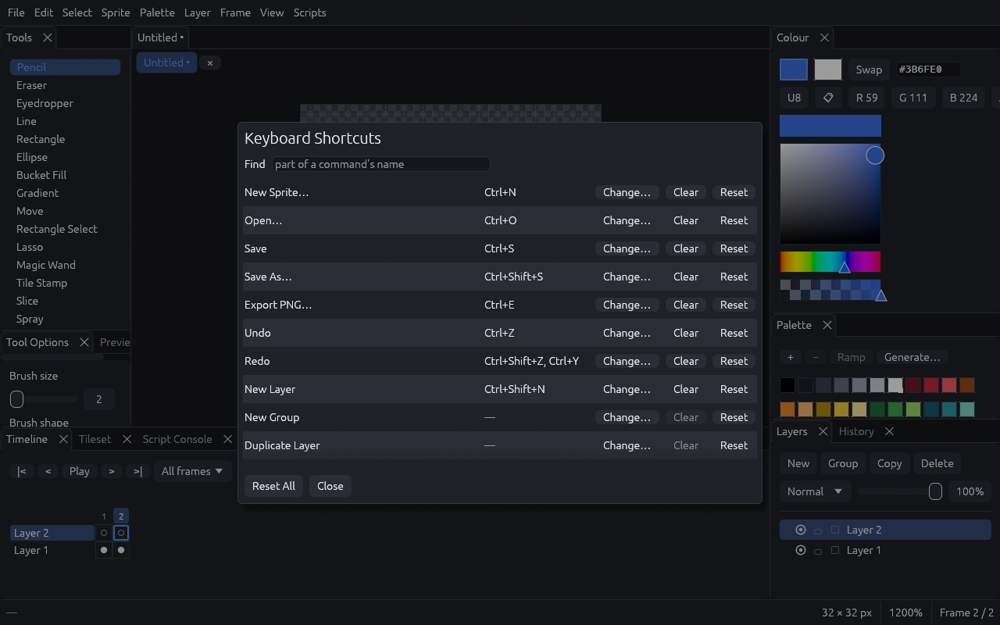
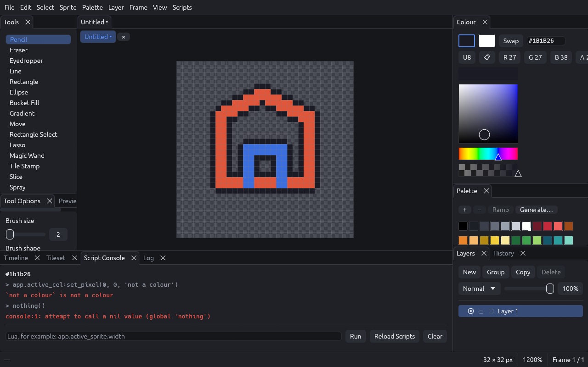

# ACMS mk3

[](https://github.com/OttoApocalypse69/ACMS-MK3/actions/workflows/ci.yml)

A pixel art editor written in Rust: drawing tools made for pixels, animation, tilemaps for
game art, and Lua scripting. It is developed on Windows; on Linux it builds and passes its
tests in CI, but has not yet been tried on a Linux desktop.

Downloads for Windows and Linux are on the
[releases page](https://github.com/OttoApocalypse69/ACMS-MK3/releases).



## What it does

- **Drawing:** pencil, eraser, line, rectangle, ellipse, bucket fill, gradient, eyedropper,
  move; rectangle, lasso and magic-wand selections; pixel-perfect strokes, symmetry (mirror
  and radial), dither and shade inks, custom brushes, tiled (wrap-around) drawing.
- **Layers:** image layers and groups, opacity, blend modes, lock and alpha lock, reference
  pictures.
- **Palettes:** import and export (`.gpl`, `.hex`, `.pal`, from a PNG), ramps, sorting,
  replace a colour, reduce a picture to the palette.
- **Animation:** frames and cels, linked cels, tags, onion skin, a timeline and a preview;
  export as GIF, spritesheet with JSON (the layout Aseprite writes), or PNG sequence.
- **Game art:** tilesets and tilemap layers, where editing one tile changes every place it is
  used; slices with 9-slice centres and pivots; export to Tiled (`.tmj`), CSV and a tileset
  picture.
- **Scripting:** Lua scripts add commands, filters and tools. See
  [scripts/API.md](scripts/API.md).
- **Everything is a command:** every action is in the command palette (`Ctrl+Shift+P`) and can
  be given a key in **Edit → Keyboard Shortcuts…**.
- **Also:** undo history with a panel to jump around in, several sprites in tabs, autosave with
  recovery after a crash, Aseprite import, a timelapse of how a sprite was made, dark and
  light themes, panels you can rearrange.

| | |
|---|---|
|  |  |
| The light theme | Every command can be given a key |
|  | |
| The Script Console, after the Outline example ran | |

## Build and run

You need a [Rust toolchain](https://rustup.rs) (stable) and a C compiler, which builds the
bundled Lua. On Linux, also the development packages of your windowing system; on
Debian or Ubuntu:

```bash
sudo apt-get install libxkbcommon-dev libwayland-dev libxcb-render0-dev libxcb-shape0-dev libxcb-xfixes0-dev
```

Then:

```bash
cargo run --release -p acms-app
```

The program is `target/release/acms-app` (`acms-app.exe` on Windows). It is a single file and
needs nothing next to it.

## First steps

1. **File → New Sprite…** and pick a size. 32 × 32 is a good start.
2. Draw with the left mouse button; the right button draws with the secondary colour. The
   wheel zooms, the middle button (or Space and drag) moves the view.
3. `Ctrl+Z` undoes. The History panel shows every step.
4. **File → Save** writes an `.acms` file; **File → Export PNG…** a picture.
5. Press `Ctrl+Shift+P` and type what you are looking for.

### Keys worth knowing

| Keys | |
|---|---|
| `B` `E` `I` | Pencil, eraser, eyedropper |
| `L` `U` `Shift+U` | Line, rectangle, ellipse |
| `G` `Shift+G` | Bucket fill, gradient |
| `V` `M` `Q` `W` | Move, rectangle select, lasso, magic wand |
| `T` `C` | Tile stamp, slice |
| `X` | Swap the two colours |
| `Ctrl+Z` / `Ctrl+Shift+Z` | Undo / redo |
| `Alt+N` / `.` / `,` / `Enter` | New frame / next / previous / play |
| `F3` | Onion skin |
| `Ctrl+G` / `Ctrl+0` | Pixel grid / zoom to fit |
| `Ctrl+Shift+P` | Command palette |

All of them can be changed in **Edit → Keyboard Shortcuts…**.

## Files

- **`.acms`** is the editor's own format: a zip archive with a readable `manifest.json` and
  one PNG per picture. Older versions of the format are upgraded when opened.
- **`.aseprite` / `.ase`** files can be opened (File → Open, File → Import Aseprite File…, or
  drop one on the window). Layers, groups, frames, linked cels, tags and slices come across;
  the editor says what did not.
- **Settings** live in the configuration folder: `%APPDATA%\acms-mk3\config` on Windows,
  `~/.config/acms-mk3` on Linux. `preferences.json`, `keymap.json` (only your changes to
  the default keys), `session.json` (recent files and the panel layout) and a `scripts`
  folder for your own scripts.
- **Autosave:** sprites with unsaved changes are copied to a recovery folder every few
  minutes (Edit → Preferences…). If the editor did not close properly, it offers them back
  the next time it starts.

## Scripting

Scripts are Lua files. The five examples in [scripts/](scripts) come with the editor and show
the main things: a filter, a command with a dialog, a command over all frames, an export, and
a tool. [scripts/API.md](scripts/API.md) is the full description. The Script Console panel
runs Lua line by line and shows what scripts print.

```lua
register_filter{
  id = "my.invert",
  name = "Invert",
  run = function(image)
    for y = 0, image.height - 1 do
      for x = 0, image.width - 1 do
        local c = image:get_pixel(x, y)
        if c.a > 0 then
          image:set_pixel(x, y, Color(255 - c.r, 255 - c.g, 255 - c.b, c.a))
        end
      end
    end
  end,
}
```

## For developers

The workspace has four crates, each depending only on the ones before it:

| Crate | |
|---|---|
| `acms-core` | The document model, undo, tools, inks, the compositor. No UI, no file access. |
| `acms-io` | The `.acms` format, imports and exports. |
| `acms-script` | The sandboxed Lua host. |
| `acms-app` | The window: panels, canvas, dialogs, keymap, command palette. |

[PLAN.md](PLAN.md) is the design; [PROGRESS.md](PROGRESS.md) records what was built, how it
was checked, and what is known not to work yet.

```bash
cargo fmt --check
cargo clippy --workspace --all-targets -- -D warnings
cargo test --workspace
```

Speed is measured, not assumed. The target is 120 frames a second while drawing on a
512 × 512 sprite with 20 layers:

```bash
cargo test --release -p acms-app -- --ignored frame_time --nocapture
```

## Licence

MIT or Apache-2.0, at your choice: see [LICENSE-MIT](LICENSE-MIT) and
[LICENSE-APACHE](LICENSE-APACHE).
